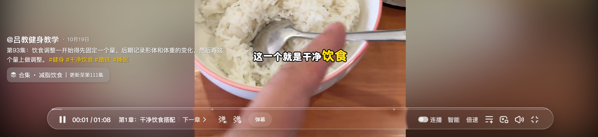
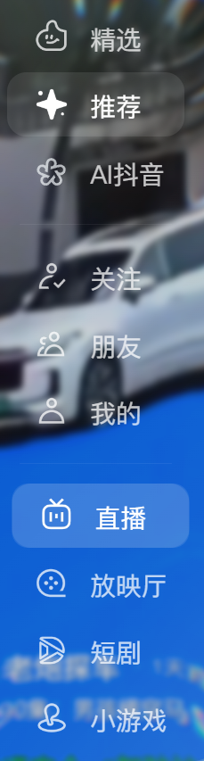

# shDouYinTools

基于咸鱼真人（lxy）的 [xyDouYinTools 6.6.10](https://greasyfork.org/zh-CN/scripts/548904) 开发的抖音网页版沉浸式优化分支，沿用原版的液态玻璃、播放控件和鼠标交互，增加精选、搜索、关注、朋友与「我的」等页面的适配。

- 顶部搜索胶囊和左侧导航支持边缘唤出。
- 精选和搜索播放弹层复用原版的浮动评论、作者小窗及液态玻璃控件。
- 修正推荐首条视频和部分图文的文案间距，适配「我的」侧栏液态玻璃。

安装 Release 中的 `shDouYinTools.user.js`，在抖音网页按 `Alt+X` 打开设置。若已启用原版或旧合并版，请先停用旧脚本以免重复处理页面。

原版作者为咸鱼真人（lxy）。本分支遵循 MIT 许可证，见 [LICENSE](LICENSE)。

## 安装教程（Tampermonkey / 油猴）

1. 在 Edge 或 Chrome 的扩展商店安装 **Tampermonkey（篡改猴）**。
2. 点击 [安装 shDouYinTools.user.js](https://github.com/gaodanbendan/shDouYinTools/releases/latest/download/shDouYinTools.user.js)，在油猴确认页点击 **安装**。如果浏览器只下载了文件，在油猴管理面板的 **实用工具** 中从文件导入。
3. 如果原版 xyDouYinTools 或旧合并版仍在运行，先在油猴管理面板停用它。
4. 刷新抖音网页，按 **Alt+X** 打开设置。开启液态玻璃后，鼠标移到页面左边缘可展开侧栏，移到顶部可唤出搜索。

升级时打开同一个安装链接，按油猴提示更新即可。

## 效果图

### 液态玻璃播放条

### 从左侧唤出的液态玻璃导航

